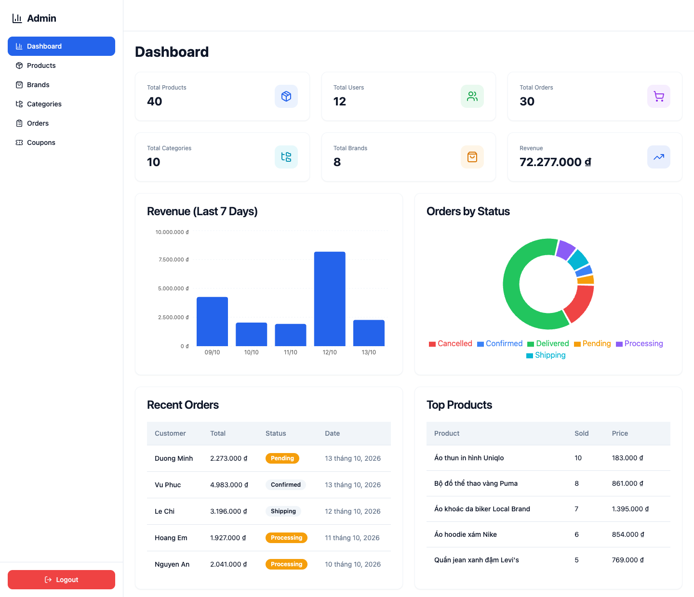

# Commerce

A full-stack e-commerce web app: a customer storefront plus an admin dashboard, backed by a modular-monolith REST API.

**Live demo:** [commerce-website-flame.vercel.app](https://commerce-website-flame.vercel.app) · **API docs (Swagger):** [commerce-website-be.onrender.com/swagger](https://commerce-website-be.onrender.com/swagger)

> The backend runs on a free tier and sleeps when idle, so the first request after a pause can take 15–50 seconds. The product list may look empty until the API wakes up.


## Features

**Storefront**

- Product catalog with search by name and filters for gender, brand, category and price range, plus sorting; product detail pages
- Brand and category browsing (categories support parent/child nesting)
- Server-side shopping cart per user
- Checkout with a saved address book, shipping method (free / standard) and payment method (cash on delivery / ZaloPay option)
- Discount coupons: percent or fixed amount, minimum order value, maximum discount, usage limit and validity window; validated at checkout and counted on use
- Order history, order detail with a tracking number, and cancellation while an order is still pending or confirmed
- Ratings and reviews (one per user per product; the product's average rating is kept in sync) and favorites (like / unlike)
- Accounts: register, login, profile update, change password; JWT auth with `user` and `admin` roles


**Admin dashboard**

- Statistics: totals, revenue, revenue over the last 7 days, orders by status, recent orders, top-selling products
- Management pages for products, brands, categories, coupons and orders (update order status, payment status and tracking number)

**API only (not wired into the UI yet):** product variants (color / size / SKU / price / stock per variant) and an image metadata registry.



## Tech stack

| Layer      | Technology                                                                                                                              |
| ---------- | --------------------------------------------------------------------------------------------------------------------------------------- |
| Frontend   | React 18, TypeScript, Vite, Tailwind CSS, Radix UI with shadcn/ui-style components, Zustand, TanStack Query, React Hook Form + Zod, React Router, Recharts |
| Backend    | Node.js, Express, TypeScript, Sequelize, PostgreSQL, Zod validation, JWT, Swagger UI                                                    |
| Deployment | Vercel (frontend), Render (backend, free tier), Neon (PostgreSQL); Dockerfile for the backend                                           |
| Tooling    | GitHub Actions CI (builds backend, frontend and the backend Docker image)                                                               |

```
Browser ──▶ Vercel (React SPA) ──HTTPS /v1──▶ Render (Express API) ──▶ Neon (PostgreSQL)
```

## Architecture

The backend ([`Commerce-be`](Commerce-be)) is a **modular monolith** organised with **Hexagonal Architecture (Ports & Adapters)**. It has 13 modules in `Commerce-be/src/modules`: `admin`, `brand`, `cart`, `category`, `coupon`, `image`, `order`, `product`, `product-like`, `product-rating`, `product-variant`, `user` and `user-address`. Modules never import each other's code; they collaborate only through small interfaces that are wired together in the composition root, `src/index.ts`.

Each module has the same layout:

```
modules/<name>/
├── model/                 entities, Zod DTOs, domain errors
├── interface/             ports: repository interfaces, cross-module service interfaces, command/query types
├── usecase/               command and query handlers (the business rules)
├── infras/
│   ├── transport/         HTTP adapter (Express handlers)
│   └── repository/sequelize/   persistence adapter (Sequelize models + repository)
└── index.ts               wires adapters → handlers → router
```

**Life of a request** (`POST /v1/orders`):

```
HTTP request
   │
   ▼
Express router (modules/order/index.ts)
   │  authMiddleware: verifies the JWT, sets req.requester
   ▼
OrderHttpService  (infras/transport)       validates the body with Zod, maps errors to HTTP status codes
   │
   ▼
CreateOrderCmdHandler  (usecase)           business rules; depends only on ports
   │
   ├──▶ IProductQueryForOrder    (port) ──▶ product repository   checks the product exists and has stock
   ├──▶ ICouponServiceForOrder   (port) ──▶ coupon adapter       validates the code, then increments usage
   └──▶ IOrderRepository         (port) ──▶ Sequelize adapter ──▶ PostgreSQL
```

**Cross-module example:** `order` does not know the `coupon` module exists. It declares `ICouponServiceForOrder` (`validate`, `incrementUsage`) in its own `interface/`. In `src/index.ts` a small adapter implements that interface by calling the coupon module's `ValidateCouponQueryHandler` and repository, and is injected into `setupOrderHexagon`. The same pattern gives `order` and `cart` product lookups through the product repository.

Writes go through command handlers (`ICommandHandler`) and reads through query handlers (`IQueryHandler`). The `admin` module is read-only reporting: it runs aggregate SQL directly instead of going through a repository.

## Project structure

```
Commerce-be/    Express API (TypeScript, Sequelize, Dockerfile)
Commerce-fe/    React SPA (Vite, Tailwind)
.github/        CI workflow
```

## Run locally

Requirements: Node.js 20+ and a PostgreSQL database. A local one works, and so does a free [Neon](https://neon.tech) project.

```bash
# optional: a local PostgreSQL
docker run -d --name commerce-pg -e POSTGRES_PASSWORD=postgres -e POSTGRES_DB=commerce -p 5432:5432 postgres:16-alpine
```

```bash
# backend
cd Commerce-be
cp .env.example .env   # set DATABASE_URL and JWT_SECRET
npm install
npm run seed           # creates the tables and demo data; prints the demo logins at the end
npm run dev            # API on http://localhost:3000, Swagger on /swagger
```

```bash
# frontend (second terminal)
cd Commerce-fe
cp .env.example .env
npm install
npm run dev            # app on http://localhost:3001
```

> `npm run seed` **truncates** all tables before inserting demo data. Missing tables are also created automatically when the API starts (`sequelize.sync()`).

Run the backend as a container:

```bash
docker build -t commerce-be ./Commerce-be
docker run --rm -p 3000:3000 -e DATABASE_URL=... -e JWT_SECRET=... commerce-be
```

### Environment variables

**Backend** (`Commerce-be/.env`)

| Variable      | Required | Description                                                                                          |
| ------------- | -------- | ---------------------------------------------------------------------------------------------------- |
| `DATABASE_URL`| yes      | PostgreSQL connection string. SSL is enabled for every host except `localhost` / `127.0.0.1`.        |
| `JWT_SECRET`  | yes in production | Secret used to sign JWTs. Use a long random value.                                          |
| `PORT`        | no       | HTTP port, default `3000`.                                                                           |
| `CORS_ORIGIN` | no       | Comma-separated list of allowed origins. Defaults to any `localhost` / `127.0.0.1` port.             |

**Frontend** (`Commerce-fe/.env`)

| Variable            | Description                                                     |
| ------------------- | --------------------------------------------------------------- |
| `VITE_API_BASE_URL` | API base URL including `/v1`, default `http://localhost:3000/v1` |
| `VITE_APP_NAME`     | App name shown in the UI, default `Commerce`                    |

## Roadmap

- Decrement stock when an order is placed, and wrap order creation and coupon usage in a single database transaction (today the order only checks stock)
- Integrate a real payment gateway (ZaloPay is currently just a selectable method stored on the order)
- Use product variants in the storefront and admin UI (the API exists; the cart currently stores a free-form attribute)
- Automated tests: unit tests for use cases such as coupon validation and order creation, plus end-to-end tests
- Admin user management and real image upload (product images are URLs today)
- Auth hardening: refresh tokens, shorter token lifetime, rate limiting

---

## Tiếng Việt

Ứng dụng thương mại điện tử full-stack gồm **storefront cho khách hàng** và **trang quản trị (admin dashboard)**, backend là REST API theo kiến trúc **modular monolith**.

**Demo:** [commerce-website-flame.vercel.app](https://commerce-website-flame.vercel.app) · **Tài liệu API:** [commerce-website-be.onrender.com/swagger](https://commerce-website-be.onrender.com/swagger)

> Backend chạy gói miễn phí và sẽ "ngủ" khi không có truy cập, nên lần truy cập đầu có thể mất 15–50 giây. Danh sách sản phẩm có thể trống cho đến khi API thức dậy.

**Điểm chính**

- Storefront: danh mục sản phẩm (tìm kiếm, lọc theo giới tính / thương hiệu / danh mục / giá, sắp xếp), giỏ hàng, thanh toán với sổ địa chỉ, mã giảm giá, lịch sử và huỷ đơn, đánh giá sản phẩm, yêu thích, tài khoản (JWT, phân quyền `user` / `admin`).
- Admin: thống kê (doanh thu 7 ngày, đơn theo trạng thái, sản phẩm bán chạy) và quản lý sản phẩm, thương hiệu, danh mục, đơn hàng, coupon.
- Chỉ có ở API (chưa có trên giao diện): biến thể sản phẩm (màu / size / SKU / giá / tồn kho).

**Stack:** React + TypeScript + Vite + Tailwind · Express + Sequelize + PostgreSQL (Neon) · Vercel + Render · Docker · GitHub Actions

**Kiến trúc:** 13 module trong `Commerce-be/src/modules`, mỗi module theo Hexagonal (Ports & Adapters): `model` → `interface` (port) → `usecase` → `infras` (adapter HTTP và Sequelize). Các module không import lẫn nhau; chúng chỉ giao tiếp qua interface, được nối ở `src/index.ts`. Ví dụ: module `order` khai báo `ICouponServiceForOrder`, còn adapter gọi sang module `coupon` được tạo và truyền vào ở `src/index.ts`. Luồng một request: route → middleware xác thực → HTTP handler (validate bằng Zod) → use case → repository (Sequelize) → PostgreSQL.

**Chạy trên máy**

```bash
# Backend (cần Node 20+ và một PostgreSQL, local hoặc Neon miễn phí)
cd Commerce-be
cp .env.example .env     # điền DATABASE_URL và JWT_SECRET
npm install
npm run seed             # tạo bảng + dữ liệu demo (XOÁ dữ liệu cũ), in tài khoản demo ở cuối
npm run dev              # http://localhost:3000, Swagger tại /swagger

# Frontend (terminal khác)
cd Commerce-fe
cp .env.example .env
npm install
npm run dev              # http://localhost:3001
```

**Hướng phát triển:** trừ tồn kho khi đặt hàng và dùng transaction; tích hợp cổng thanh toán thật; dùng biến thể sản phẩm trên giao diện; viết test tự động; quản lý user và upload ảnh cho admin; tăng cường bảo mật auth (refresh token, rate limit).
